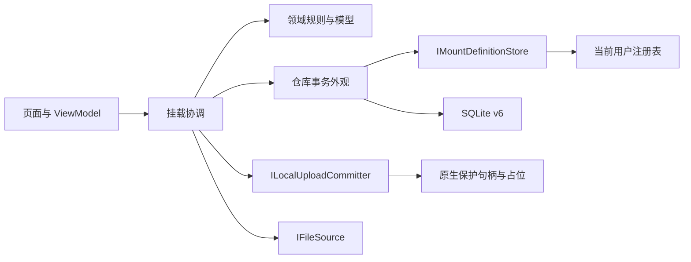

# 0.0.8.7 挂载职责检查与拆分

本次逐一检查 65 个原 Services/Mounting 文件。协议专用文件保留原位，0.0.8.8 再一次迁移；以下归属与代码提取共同构成本版，未用移动文件代替职责拆分。

## 实际拆分

- UploadRules 拥有类型一致性、内容变化、重试状态、发送／未决状态和远端删除屏障；MountManager、仓库和 CFAPI 提交使用同一规则，模型不依赖 Services 或原生类型。
- MountDefinitionRules 校验原持久字段；IMountDefinitionStore 与默认 RegistryMountDefinitionStore 拥有定义及缓存偏好，MountDatabase 独立拥有 SQLite 连接／v6 初始化，仓库保留事务和映射协调。建表 SQL 逐字保持。
- ILocalUploadCommitter 将协调器与 CFAPI 提交隔开；默认适配器仍以原保护句柄提交，并在同一范围返回状态戳。仓库不再通过 CFAPI 类执行类型规则。
- SourceReadDiagnostic、HydrationProcess 数据归模型，IReadDiagnosticsSource 归公共契约；指针复制及环境开关留在 CFAPI 服务，不让模型引用原生内存。
- RelativePathRules 拥有受限映射算法，原公开 RelativePaths 仅保留兼容转发。会话故障合并算法 NetworkFailureLog 归模型；预览工作进程／解码、文件系统及传输资源保留服务职责。

## 命名空间与兼容边界

现有 MountManager、MountRepository、文件源和系统适配器的公共入口继续保留 HybridMount.Services.Mounting 命名空间，partial 类型也保持同一声明空间；具体文件按职责分组。新领域类型使用 HybridMount.Models.Mounting，定义／提交／诊断契约使用 HybridMount.Common，内部注册表与数据库实现使用 HybridMount.Services.Mounting.Persistence。默认构造调用兼容，新增注入参数为可选。

测试工程对模型／服务递归登记，使用独立 Link 根；结构审计验证当前 84 个挂载文件各编译一次，无遗漏／重复。领域模型不反向引用 Services 或 P/Invoke；原生和持久化适配器不引入新的工程依赖。JSON 字段、数据库、游标、DPAPI、配置根和任务语义不变。

## 逐文件归属

| 原文件 | 本版归属（相对 HybridMount） | 职责 |
| --- | --- | --- |
| CloudFilesNative.cs | Services/Mounting/CFAPI/CloudFilesNative.cs | CFAPI |
| CloudMountSession.RemoteContent.cs | Services/Mounting/CFAPI/CloudMountSession.RemoteContent.cs | CFAPI |
| CloudMountSession.cs | Services/Mounting/CFAPI/CloudMountSession.cs | CFAPI |
| CloudRemoteCleanup.cs | Services/Mounting/CFAPI/CloudRemoteCleanup.cs | CFAPI |
| CloudRemoteUpdate.cs | Services/Mounting/CFAPI/CloudRemoteUpdate.cs | CFAPI |
| CloudRootRegistration.cs | Services/Mounting/CFAPI/CloudRootRegistration.cs | CFAPI |
| CloudUploadState.cs | Services/Mounting/CFAPI/CloudUploadState.cs | CFAPI |
| CredentialStore.cs | Services/Mounting/Configuration/CredentialStore.cs | Configuration |
| ExeIconExtractor.cs | Services/Mounting/Preview/ExeIconExtractor.cs | Preview |
| ExePreviewCache.cs | Services/Mounting/Preview/ExePreviewCache.cs | Preview |
| FileSourceFactory.cs | Services/Mounting/Sources/FileSourceFactory.cs | Sources |
| HydrationDiagnostics.cs | Services/Mounting/CFAPI/HydrationDiagnostics.cs | CFAPI |
| LegacyRecoverySource.cs | Services/Mounting/Sources/LegacyRecoverySource.cs | Sources |
| LocalFileMetadata.cs | Services/Mounting/FileSystem/LocalFileMetadata.cs | FileSystem |
| LocalFileState.cs | Services/Mounting/FileSystem/LocalFileState.cs | FileSystem |
| MountBackupCodec.cs | Services/Mounting/Configuration/MountBackupCodec.cs | Configuration |
| MountContentCleaner.cs | Services/Mounting/FileSystem/MountContentCleaner.cs | FileSystem |
| MountManager.Capacity.cs | Services/Mounting/Coordination/MountManager.Capacity.cs | Coordination |
| MountManager.ConfigurationBackup.cs | Services/Mounting/Coordination/MountManager.ConfigurationBackup.cs | Coordination |
| MountManager.Lifecycle.cs | Services/Mounting/Coordination/MountManager.Lifecycle.cs | Coordination |
| MountManager.Previews.cs | Services/Mounting/Coordination/MountManager.Previews.cs | Coordination |
| MountManager.RemoteApply.cs | Services/Mounting/Coordination/MountManager.RemoteApply.cs | Coordination |
| MountManager.RemoteDeletion.cs | Services/Mounting/Coordination/MountManager.RemoteDeletion.cs | Coordination |
| MountManager.RemoteSync.cs | Services/Mounting/Coordination/MountManager.RemoteSync.cs | Coordination |
| MountManager.Sqs.cs | Services/Mounting/MountManager.Sqs.cs | 协议专用，0.0.8.8 迁移 |
| MountManager.UploadSnapshot.cs | Services/Mounting/Coordination/MountManager.UploadSnapshot.cs | Coordination |
| MountManager.UploadWorker.cs | Services/Mounting/Coordination/MountManager.UploadWorker.cs | Coordination |
| MountManager.Uploads.cs | Services/Mounting/Coordination/MountManager.Uploads.cs | Coordination |
| MountManager.cs | Services/Mounting/Coordination/MountManager.cs | Coordination |
| MountPathGuard.cs | Services/Mounting/FileSystem/MountPathGuard.cs | FileSystem |
| MountRepository.RemoteScans.cs | Services/Mounting/Persistence/MountRepository.RemoteScans.cs | Persistence |
| MountRepository.RemoteState.cs | Services/Mounting/Persistence/MountRepository.RemoteState.cs | Persistence |
| MountRepository.RemoteSync.cs | Services/Mounting/Persistence/MountRepository.RemoteSync.cs | Persistence |
| MountRepository.S3Events.cs | Services/Mounting/MountRepository.S3Events.cs | 协议专用，0.0.8.8 迁移 |
| MountRepository.Temporary.cs | Services/Mounting/MountRepository.Temporary.cs | 协议专用，0.0.8.8 迁移 |
| MountRepository.Uploads.cs | Services/Mounting/Persistence/MountRepository.Uploads.cs | Persistence |
| MountRepository.cs | Services/Mounting/Persistence/MountRepository.cs | Persistence |
| NetworkFailureLog.cs | Models/Mounting/NetworkFailureLog.cs | 领域内的会话故障合并算法 |
| PreviewRangeBudget.cs | Services/Mounting/Preview/PreviewRangeBudget.cs | Preview |
| PreviewRangeReads.cs | Services/Mounting/PreviewRangeReads.cs | 协议专用，0.0.8.8 迁移 |
| PreviewWorker.cs | Services/Mounting/Preview/PreviewWorker.cs | Preview |
| PreviewWorkerClient.cs | Services/Mounting/Preview/PreviewWorkerClient.cs | Preview |
| PriorityReadQueue.cs | Services/Mounting/Content/PriorityReadQueue.cs | Content |
| ProtectedResourceStream.cs | Services/Mounting/Content/ProtectedResourceStream.cs | Content |
| RelativePaths.cs | Services/Mounting/FileSystem/RelativePaths.cs | FileSystem |
| RemoteCapacitySession.cs | Services/Mounting/Coordination/RemoteCapacitySession.cs | Coordination |
| RemoteSyncEngine.cs | Services/Mounting/Coordination/RemoteSyncEngine.cs | Coordination |
| S3EventParser.cs | Services/Mounting/S3EventParser.cs | 协议专用，0.0.8.8 迁移 |
| S3FileSource.cs | Services/Mounting/S3FileSource.cs | 协议专用，0.0.8.8 迁移 |
| S3RemoteChanges.cs | Services/Mounting/S3RemoteChanges.cs | 协议专用，0.0.8.8 迁移 |
| S3Uploads.cs | Services/Mounting/S3Uploads.cs | 协议专用，0.0.8.8 迁移 |
| SharedAsyncWork.cs | Services/Mounting/Content/SharedAsyncWork.cs | Content |
| SqsEventHub.cs | Services/Mounting/SqsEventHub.cs | 协议专用，0.0.8.8 迁移 |
| SqsQueueClient.cs | Services/Mounting/SqsQueueClient.cs | 协议专用，0.0.8.8 迁移 |
| UploadProgressStream.cs | Services/Mounting/Content/UploadProgressStream.cs | Content |
| WebDavCapacity.cs | Services/Mounting/WebDavCapacity.cs | 协议专用，0.0.8.8 迁移 |
| WebDavCollectionSync.cs | Services/Mounting/WebDavCollectionSync.cs | 协议专用，0.0.8.8 迁移 |
| WebDavCreateMove.cs | Services/Mounting/WebDavCreateMove.cs | 协议专用，0.0.8.8 迁移 |
| WebDavFileSource.cs | Services/Mounting/WebDavFileSource.cs | 协议专用，0.0.8.8 迁移 |
| WebDavLocks.cs | Services/Mounting/WebDavLocks.cs | 协议专用，0.0.8.8 迁移 |
| WebDavNetworkDiagnostics.cs | Services/Mounting/WebDavNetworkDiagnostics.cs | 协议专用，0.0.8.8 迁移 |
| WebDavTemporary.cs | Services/Mounting/WebDavTemporary.cs | 协议专用，0.0.8.8 迁移 |
| WebDavTransport.cs | Services/Mounting/WebDavTransport.cs | 协议专用，0.0.8.8 迁移 |
| WebDavUploads.cs | Services/Mounting/WebDavUploads.cs | 协议专用，0.0.8.8 迁移 |
| WholeFileCache.cs | Services/Mounting/Content/WholeFileCache.cs | Content |
